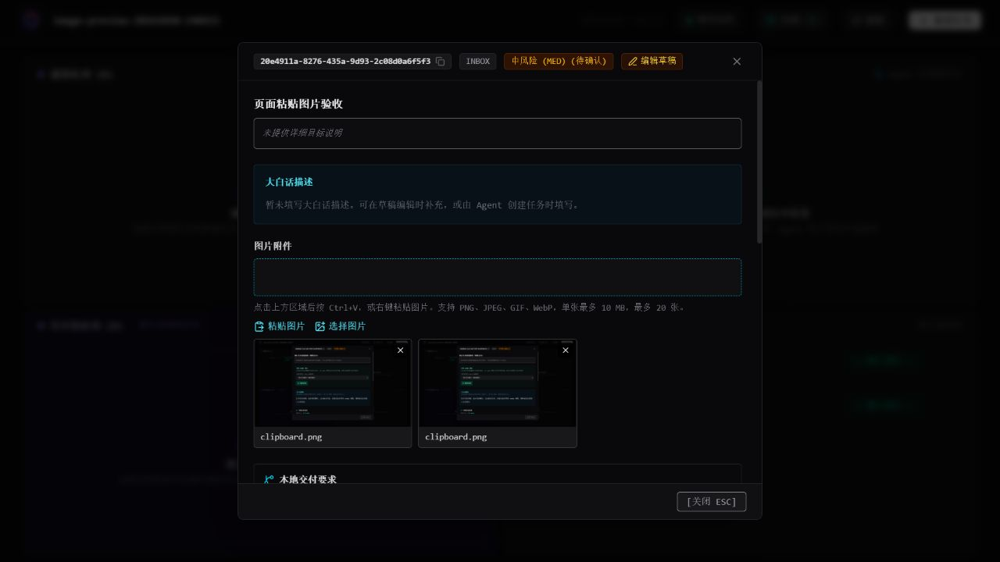

# MileStack-new · 定制版

[简体中文](README.md) | [English](README.en.md)

**把项目进度、业务说明、参考图片和 Codex 执行入口放在同一个本地任务面板里。**

本项目基于 [SuperYang006/MileStack](https://github.com/SuperYang006/MileStack) 0.2.1 开发，保留本地 SQLite、任务队列、依赖、MCP 协作和跨会话接续能力。开发者和编程 Agent 共用任务记录，随时知道项目做到哪里、接下来做什么。

当前版本：**0.2.1-custom.1**。全局命令仍为 **`milestack`**。

## 新版定制功能

| 功能 | 使用效果 |
| --- | --- |
| 大白话描述 | 独立记录业务功能、操作步骤和预期结果；详情保留段落，不替代技术验收标准。 |
| 页面执行任务 | 就绪任务详情点击【执行任务】，交给本项目的现有 Codex 桌面聊天；保留对话领取方式。 |
| 图片双向传递 | 页面可 Ctrl+V、右键粘贴或选择图片；Codex 创建任务可附图，也能读取页面上传的图片。 |
| 图片预览 | 详情显示缩略图，点击预览大图，支持新窗口查看；图片副本保存在项目本地。 |
| 自动递增端口 | 多项目同时启动时，从 7331 依次尝试 7332、7333，打印各自实际访问地址。 |
| 人工验收归档 | Git 提交可选；提交或 AI 审核后等待开发者确认，人工批准或直接验收后归档。前置任务提交审核后可推进后续任务。 |
| 独立源码构建 | 拉取本仓库即可构建、打包和全局安装，不依赖原电脑的安装备份或生成代码补丁。 |



## 安装

需要 **Node.js 22 或以上，推荐 Node.js 24 LTS**，以及 Git。源码开发使用 `pnpm@10.29.2`；安装打包后的 CLI 只需 Node.js 和 npm。

### 拉取源码，全局安装

```powershell
git clone https://github.com/jiaranpeng/MileStack-new.git
cd MileStack-new
corepack enable
pnpm install --frozen-lockfile
npm install --global .
milestack --version
```

安装源码依赖时，`prepare` 自动构建 CLI 和网页。已安装依赖时，也可手动运行 `pnpm build`。使用 `npm install` 安装源码依赖时同样会自动构建。

本地目录安装适合保留源码目录的开发方式。需要独立于源码目录运行时，推荐打包安装：

```powershell
# 在仓库根目录执行；打包时自动检查类型、运行测试并构建
npm pack
npm install --global ./milestack-0.2.1-custom.1.tgz
```

提交并推送本版本后，也可直接从 GitHub 全局安装，由 npm 下载源码并构建：

```powershell
npm install --global "git+https://github.com/jiaranpeng/MileStack-new.git"
```

**`npm install --global milestack` 安装的是上游 npm 包。** 安装本定制版请使用本仓库目录、上面的 Git URL 或本版压缩包。

## 三分钟开始使用

进入需要管理的业务项目目录：

```powershell
cd D:\work\your-project
milestack init --client codex
milestack serve
```

打开终端打印的实际地址，例如 `http://127.0.0.1:7331`。在该业务项目根目录的 `AGENTS.md` 加入：

```md
Before working on tasks, read and follow `.milestack/agent-instructions.md`.
```

重连项目 MCP 或重启 Codex 后，即可让 Agent 创建、读取和领取任务。初始化不会覆盖现有 `AGENTS.md` 或全局客户端配置。

其他客户端可使用 `--client claude`、`cursor`、`grok` 或 `opencode`，也可重复指定 `--client`。基本任务管理和对话领取不依赖桌面执行按钮。

## 在页面执行任务

```text
新建任务 → 草稿箱 → 确认排队 → 就绪任务详情 → 执行任务
新建任务 → 选择就绪队列 → 就绪任务详情 → 执行任务
```

首次在详情中选择当前项目的 Codex 桌面聊天，浏览器会记住选择。点击按钮后先显示“已发送，等待领取”；Codex 实际调用 `get_task → start_task` 成功后，任务才进入“正在进行”。也可继续在聊天中指定任务 ID 领取。

桌面执行的连接条件：

- 已在 Windows Codex 桌面版打开对应项目聊天，并连接本项目的 MileStack MCP。
- 首次配对时，在 Codex 本地聊天中让 Agent 启动该项目的 `milestack serve`，使服务取得真实的桌面连接上下文；打开就绪任务详情读取聊天列表后，会保存项目本地连接。
- 配对后，普通终端启动可复用连接；桌面版须保持打开。页面提示未连接时，请重新配对。

聊天忙、依赖未满足、风险未确认或项目已有领取中任务时，页面会说明原因。重复点击不重复派发；发送结果不确定时不自动重发，请查看目标聊天。桌面连接依赖 Codex 内置本地工具，已在 Windows 验证；CLI、网页和普通 MCP 任务管理可独立使用。

## 图片与 Codex 计划协作

在新建、草稿编辑或详情的图片区域按 **Ctrl+V**、右键粘贴、点击【粘贴图片】或【选择图片】即可加图。点击缩略图预览，可移除附件引用。

支持 PNG、JPEG、GIF、WebP，**每张最多 10 MB，每个任务最多 20 张**。浏览器限制读取剪贴板时，可点击粘贴区域再按 Ctrl+V，或选择图片文件。

Codex 创建任务时可一起传入计划图片，以下为 MCP `create_task` 示例：

```json
{
  "title": "按参考图调整设置页面",
  "plainLanguageDescription": "让用户保存配置，再通过独立按钮应用配置。",
  "imagePaths": ["D:/work/your-project/docs/settings-reference.png"],
  "acceptanceCriteria": ["布局和操作顺序符合参考图，保存与应用操作相互独立。"]
}
```

`create_tasks` 同样支持。也可先用 `import_task_image` 导入图片，再传 `imageIds`。Agent 用 `get_task` 获取附件列表，再用 `get_task_image(taskId, imageId)` 查看实际图片。

图片复制到 `.milestack/images/`，原文件移动后仍可读取。不会扫描聊天历史或自动补录旧计划图片；图片需要有可读取的本地路径或图片内容。新增工具后，旧 MCP 会话需重连。

## 多项目同时运行

在不同项目的终端分别执行 `milestack serve`。第一个进程通常使用 `127.0.0.1:7331`，第二个使用 `7332`，第三个使用 `7333`；端口被占用时继续递增，每个进程管理自己的项目。

指定 `milestack serve --port 8000` 时，从 8000 开始寻找可用端口。以终端打印的地址为准。

## 数据、备份和升级

任务保存在 `.milestack/milestack.db`，图片在 `.milestack/images/`，另有生成指令和派发记录。**备份整个业务项目的 `.milestack/`**，不要只复制数据库。数据库升级前会自动备份，再执行前向迁移。

升级本版：拉取本仓库更新，重新安装依赖、构建和全局安装，再重启服务与 MCP。`milestack update` 仅检查或刷新项目生成规则，不会用上游 npm 包覆盖定制版。

默认 `.gitignore` 排除项目数据、图片附件、桌面连接信息、`node_modules`、`dist`、压缩安装包和本地 IDE 配置。

## 开发与验证

```powershell
pnpm typecheck
pnpm typecheck:ui
pnpm test
pnpm build
```

详见 [定制版维护说明](docs/local-customization.zh-CN.md)、[用户指南](docs/user-guide.zh-CN.md) 和 [开发指南](docs/development.zh-CN.md)。上游历史文档中的固定 Git 提交和集成门槛对应保留的兼容策略；本版默认使用人工验收工作流。

## 来源与许可证

感谢 [SuperYang006/MileStack](https://github.com/SuperYang006/MileStack)。本版基于其 0.2.1 源码定制，沿用 [Apache License 2.0](LICENSE)，保留原项目来源。变更见 [CHANGELOG.md](CHANGELOG.md)。
